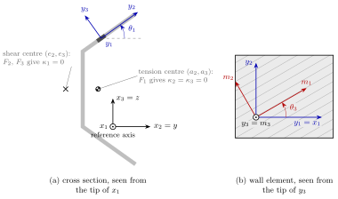

Cross-sectional analysis of beams
=================================

The beam elements :class:`.BeamC` and :class:`.BeamLR` assume a rigid
cross section: the section only enters through the integrals of a
:class:`.BeamProp`, and the torsional stiffness ``GJ`` and the shear
moduli ``G12`` and ``G13``, with their correction factors, must be given by
the user, see :doc:`shell_properties`. The module :mod:`pyfe3d.vabs`
computes these stiffnesses, and the couplings between them, for an
arbitrary cross section made of anisotropic and non-homogeneous materials,
with the variational asymptotic beam sectional analysis (VABS) of Cesnik
and Hodges (1997) and Yu et al. (2002, 2012): the three-dimensional
elasticity problem of a slender prismatic beam is split into a
two-dimensional problem over the cross section, solved here with finite
elements, and a one-dimensional beam problem, governed by the resulting
sectional stiffness matrix.

Steps of an analysis
--------------------

1. **Mesh.** Node coordinates `x_2`, `x_3`, the `y` and `z` of the beam
   elements, and the connectivity of 3- or 6-node triangles and 4-, 8- or
   9-node quadrilaterals, numbered counter-clockwise, see
   :class:`.CrossSection`. The origin of `x_2`, `x_3` is the reference axis
   of the beam: all results refer to it, and it need not be the centroid.
2. **Materials.** One `6 \times 6` material matrix per material, in its
   material axes, e.g. from :func:`.isotropic` or :func:`.orthotropic`, and
   per element the material index and two angles: `\theta_1`, which
   orients the local axes of the element, e.g. along a wall, and the ply
   angle `\theta_3`, see :func:`.rotate_material`.
3. **Classical model.** :meth:`.CrossSection.calc_stiffness` solves the
   warping of the cross section for the four classical strain measures,
   extension, twist and two bending curvatures, and condenses it into the
   `4 \times 4` stiffness ``Kc``. This is the generalized Euler-Bernoulli
   model: the warping softens the rigid section, gives the Saint-Venant
   torsional stiffness, and populates the couplings of anisotropic
   sections.
4. **Generalized Timoshenko model.** The same factorization gives the
   first correction of the warping, driven by the derivatives of the
   classical strains along the beam, and the second-order energy is
   transformed into the `6 \times 6` stiffness ``Kt``, which adds the two
   transverse shear strains. Its shear entries contain the shear
   correction factors and the location of the shear centre, which are not
   assumed. The theory of these two steps is in the notes of
   :meth:`.CrossSection.calc_stiffness`, and the discretization in those
   of the kernel ``_integrate`` of :mod:`pyfe3d.vabs`.
5. **Derived quantities.** The flexibilities ``Fc`` and ``Ft``, the tension
   and shear centres, and, with :meth:`.CrossSection.calc_mass`, the mass
   matrix and the mass integrals of :class:`.BeamProp`.
6. **Use in the beam elements.** :func:`.yu_to_pyfe3d` converts the
   matrices to the convention of pyfe3d, and :func:`.beamprop_from_vabs`
   creates the :class:`.BeamProp`, when the matrix can be represented by
   one, see below.
7. **Generalized Vlasov model.** For thin-walled open sections,
   :meth:`.CrossSection.calc_vlasov` gives the `5 \times 5` stiffness
   ``Kv``, which adds the restrained warping, see below.

The analysis is linear and per station: a beam whose section varies along
its length needs one analysis per station.

Axes, angles and centres
------------------------

   (a) Flared channel of constant thickness, made of one isotropic
   material, with the tension and shear centres computed by
   :meth:`.CrossSection.calc_stiffness`, and an element of the upper
   flange with its local axes; (b) that element seen from the tip of
   `y_3`, with its material axes.

The beam axis `x_1` points to the viewer of the cross section and `x_2`,
`x_3` are the `y`, `z` of :class:`.BeamC` and :class:`.BeamLR`, with the
origin at the reference axis. Each element has two angles, see
:func:`.rotate_material`:

- `\theta_1` (``theta1``) rotates the local axes `y_2`, `y_3` of the
  element about `y_1 = x_1`, positive from `x_2` towards `x_3`; for a
  wall, `y_2` is usually taken along the wall and `y_3` across it;
- `\theta_3` (``theta3``) rotates the material axes `m_1`, `m_2` about
  `m_3 = y_3`, positive from `y_1` towards `y_2`; for a laminated wall,
  it is the ply angle measured from the beam axis.

The tension centre `(a_2, a_3)` is the point where an axial force `F_1`
gives no bending curvature, `\kappa_2 = \kappa_3 = 0`, and the shear
centre `(e_2, e_3)` the point where the transverse forces `F_2`, `F_3`
give no twist, `\kappa_1 = 0`. Both are measured from the reference axis.
For the homogeneous channel of the figure, the tension centre is the
centroid and the shear centre lies outside the section, on the side of
the web opposite to the flanges.

This convention of the angles reproduces all the signs of the box beam
CUS computed with VABS 3.2 by Yu et al. (2012). With it, two other
published examples give three couplings each with the published magnitude
and the opposite sign, which is attributed to the labelling of their axes
and ply angles: the box beam CAS1 of Yu et al. (2002) and the pipe of Yu
and Hodges (2005), see the notes of :func:`.rotate_material` and
``tests/test_vabs_composite.py``.

Two conventions
---------------

The matrices of :class:`.CrossSection` are written in the convention of
the VABS literature, which orders the strains as `\{\gamma_{11},
2\gamma_{12}, 2\gamma_{13}, \kappa_1, \kappa_2, \kappa_3\}` and defines
the curvatures as the components of the curvature vector, i.e. the rates
of rotation about `x_1`, `x_2` and `x_3`. The beam elements of pyfe3d use
`\{\bar{\varepsilon}, \bar{\gamma}_y, \bar{\gamma}_z, \kappa_x, \kappa_y,
\kappa_z\}`, with `\kappa_y` and `\kappa_z` named after the coordinate
they multiply in the axial strain, see the notes of :class:`.BeamC`. The
two agree on the extension, the shear strains and the twist, while
`\kappa_2 = \kappa_z` and `\kappa_3 = -\kappa_y`; the moments are `M_2 =
M_y` and `M_3 = -M_z`. Hence, when the reference axis is offset from the
centroid by `d_2` along `x_2`, the coupling of the extension with
`\kappa_3` is `-E A d_2` in ``Kt`` and the coupling with `\kappa_y` is `E
A d_2 = E Q_z` after :func:`.yu_to_pyfe3d`, as in the rigid section of
:class:`.BeamC`; this is checked in ``tests/test_vabs_isotropic.py``.

The ordering of the classical model is the same without the shear
strains, and the classical model is recovered from the Timoshenko one by
a condensation of the flexibility, :func:`.classical_from_timoshenko`,
not by deleting rows and columns of the stiffness.

From the sectional matrix to the beam elements
----------------------------------------------

A :class:`.BeamProp` has 11 cross-section parameters, against the 21
independent entries of a `6 \times 6` stiffness matrix: the elements of
pyfe3d cannot represent the extension-shear, extension-twist,
bending-shear and bending-twist couplings, and their shear centre is the
tension centre. :func:`.beamprop_from_vabs` therefore converts a matrix
only when it has the pattern of a :class:`.BeamProp`, e.g. for isotropic
sections whose shear centre is the tension centre, and raises an error
otherwise; the element code is not changed. For such sections the
computed ``G12``, ``G13`` and ``GJ`` replace the shear correction factors
and the torsion constant that the user would otherwise supply.

Generalized Vlasov model
------------------------

In a thin-walled open section, a twist rate that varies along the beam
produces axial stresses through the warping, with a stiffness that can
exceed the Saint-Venant ``GJ`` by far, which neither the classical nor the
Timoshenko model represents. Following Yu et al. (2005), Section 2,
:meth:`.CrossSection.calc_vlasov` moves the origin of the cross section
to the shear centre with :meth:`.CrossSection.translated`, analyses the
translated section, and keeps, in its second-order energy, only the
derivative `\kappa_1'` of the twist rate among the derivatives of the
classical strains. The result is the `5 \times 5` stiffness ``Kv`` of the
strains `\{\gamma_{11}, \kappa_1, \kappa_2, \kappa_3, \kappa_1'\}`
referred to the shear centre, work-conjugate to `\{F_1, M_1, M_2, M_3,
M_\omega\}`, with the bimoment `M_\omega`; its last diagonal entry is the
warping rigidity, `E\Gamma` for an isotropic thin-walled section::

    sec.calc_vlasov()
    EGamma = sec.Kv[4, 4]
    w1 = sec.vlasov_section.warping([0., 1., 0., 0.])[:, 0]

The first four rows and columns are the classical stiffness about the
shear centre. The model is computed by default with the warping
constraints of Yu et al. (2002), ``constraint='yu2002'``, which reproduce
the VABS results of Yu et al. (2005) and, for a strip, their asymptotic
thin-walled warping rigidity. The constraints of Yu et al. (2012),
``constraint='yu2012'``, the default of
:meth:`.CrossSection.calc_stiffness`, differ in the fourth constraint, on
the rotation of the in-plane warping. They give the same first four rows
and columns of ``Kv`` and, in the tested cases, the same shear centre, but
a different warping rigidity ``Kv[4, 4]``, lower for strips and nearly
equal for I- and channel sections. For the cases of ``tests/test_vabs_vlasov.py``, with
`E = 10^7` and `\nu = 0.3` for the isotropic ones:

.. list-table::
   :header-rows: 1

   * - Case
     - ``'yu2002'``
     - ``'yu2012'``
     - Reference
   * - Isotropic strip, Table 1 of Yu et al. (2005)
     - 1.78634
     - 1.61715
     - VABS 1.78635; `E h^3 b^3/[144(1 - \nu^2)]` = 1.78336;
       `E h^3 b^3/144` = 1.62286
   * - Orthotropic strip, Table 3
     - 3.39252
     - 3.32682
     - VABS 3.39251
   * - Anisotropic strip, 15 degrees, Table 4
     - 1.82501
     - 1.59940
     - VABS 1.82499
   * - Isotropic I-beam, Table 5, mesh of the paper
     - 3518.92
     - 3515.17
     - VABS 3553.43; thin-walled `E t b_f^3 h^2/24` = 3526.67
   * - Channel, `t = 0.01`
     - 912.037
     - 911.853
     - thin-walled `E \Gamma` = 911.458

The torsional warping `w_1` per unit twist rate is the same for both. No
beam element of pyfe3d has a
warping degree-of-freedom: ``Kv`` is an output for one-dimensional
Vlasov beam analyses outside pyfe3d, such as that of Section 3 of Yu et
al. (2005).

Plotting the warping
--------------------

After :meth:`.CrossSection.calc_stiffness`, :meth:`.CrossSection.warping`
returns the warping displacements `w_1, w_2, w_3` of the nodes for given
strains of the beam, and :meth:`.CrossSection.triangles` a triangulation of
the mesh through all its nodes. These two arrays are all that a plotting
library needs, and pyfe3d does not depend on any. The warping satisfies
the constraints chosen in :meth:`.CrossSection.calc_stiffness`, among them
zero average, and it is the warping relative to the rigid motion of the
section about the reference axis. In the tested cases, the two sets of
constraints, ``'yu2012'`` and ``'yu2002'``, give the same out-of-plane
warping per unit classical strain, but they can differ in the in-plane
warping and in the
term of the derivatives of the strains; :meth:`.CrossSection.translated`
does not depend on them.

The torsional warping is therefore shown, as in the literature, about the
shear centre: the section translated to the shear centre with
:meth:`.CrossSection.translated`, as in :meth:`.CrossSection.calc_vlasov`,
gives the warping relative to the rotation about the shear centre, with
zero average. For a thin-walled open section it is the principal
sectorial coordinate `\omega` of Vlasov (1961), `\omega = \int \rho \,
ds`, `\rho` being the distance from the pole to the tangent of the
mid-line, normalised with the pole at the shear centre such that
`\omega` has zero average and is orthogonal to `x_2` and `x_3`: with
`\rho` positive when the radius from the pole turns from `x_2` towards
`x_3`, the absence of shear strain on the mid-line gives `w_1 = -\omega
\kappa_1`. This is checked for a channel in
``tests/test_vabs_vlasov.py``.

With matplotlib, for a thin-walled channel, the out-of-plane warping
`w_1` per unit twist rate `\kappa_1` about the shear centre (cross), with
the tension centre (circle), and the in-plane warping per unit curvature
`\kappa_2`, i.e. the anticlastic deformation due to the Poisson effect,
drawn to scale on the undeformed mesh: the flange in tension, `x_3 > 0`,
contracts, and the flange in compression expands. The torsional warping
is linear along each wall, `-\omega`, and changes sign on the web, at the
centre of the section, and along the flanges.

.. plot::
   :include-source:

   import numpy as np
   import matplotlib.pyplot as plt
   from matplotlib.tri import Triangulation

   from pyfe3d.vabs import CrossSection, isotropic

   # channel: web of height h along x3, flanges of width b along x2,
   # thickness t, meshed with bilinear quadrilaterals of side t/2
   h, b, t = 1., 0.5, 0.05
   d = t/2
   xs = np.linspace(0., b, round(b/d) + 1)
   ys = np.linspace(-h/2, h/2, round(h/d) + 1)
   X2, X3 = np.meshgrid(xs, ys)
   nx = xs.size
   elements = []
   for j in range(ys.size - 1):
       for i in range(nx - 1):
           xc, yc = (xs[i] + xs[i + 1])/2, (ys[j] + ys[j + 1])/2
           if xc < t or abs(yc) > h/2 - t:
               n = j*nx + i
               elements.append([n, n + 1, n + 1 + nx, n + nx])
   used = np.unique(elements)
   new = -np.ones(X2.size, dtype=int)
   new[used] = np.arange(used.size)
   x2, x3 = X2.ravel()[used], X3.ravel()[used]
   elements = new[np.array(elements)]

   sec = CrossSection(x2, x3, elements, materials=[isotropic(70e9, 0.3)],
                      mat_ids=[0]*len(elements))
   sec.calc_stiffness()
   tri = Triangulation(sec.x2, sec.x3, sec.triangles())
   # origin at the shear centre, same nodes and triangles
   sc = sec.translated(*sec.shear_centre)
   sc.calc_stiffness()

   fig, (ax1, ax2) = plt.subplots(1, 2, figsize=(9, 4.5))
   w = sc.warping([0., 1., 0., 0.])  # unit twist rate kappa1
   cs = ax1.tricontourf(tri, w[:, 0], levels=21, cmap='RdBu_r')
   fig.colorbar(cs, ax=ax1, label=r'$w_1 = -\omega$ per unit $\kappa_1$')
   ax1.plot(*sec.tension_centre, 'ko', mfc='none')
   ax1.plot(*sec.shear_centre, 'kx')
   ax1.set_title('torsion, about the shear centre')

   w = sec.warping([0., 0., 1., 0.])  # unit curvature kappa2
   ax2.triplot(tri, color='0.8', lw=0.5)
   ax2.triplot(sec.x2 + w[:, 1], sec.x3 + w[:, 2], sec.triangles(),
               color='C0', lw=0.5)
   ax2.set_title('bending, in-plane warping')
   for ax in (ax1, ax2):
       ax.set_aspect('equal')
       ax.set_xlabel('$x_2$')
       ax.set_ylabel('$x_3$')
   fig.tight_layout()

The same arrays give a three-dimensional view with plotly. The script
below draws the channel as a beam of length 3 under a uniform twist rate:
the sections rotate about the shear centre and warp along the beam by
`w_1 = -\omega \kappa_1`, the warping being exaggerated and coloured by
`w_1`. The figure can be rotated, panned and zoomed:

.. literalinclude:: _scripts/vabs_warping_3d.py
   :start-at: import numpy as np
   :end-before: # NOTE written for the documentation

.. raw:: html
   :file: _generated/vabs_warping_3d.html

Validation
----------

The tests compare the results with elasticity solutions and with
published VABS results:

- ``tests/test_vabs_isotropic.py``: rectangles, circles and tubes, with the
  axial and bending stiffnesses, the Saint-Venant torsion constant and the
  shear correction factors of the elasticity solutions, Eq. (25) of Yu and
  Hodges (2005) for the rectangle; the isotropic square of Yu et al.
  (2002), the T-section of Yu and Hodges (2005), and the couplings of an
  offset reference axis;
- ``tests/test_vabs_composite.py``: the box beam CUS of Yu et al. (2012),
  reproduced to the four digits of their VABS 3.2 results, the
  anisotropic pipe of Yu and Hodges (2005), with its mass properties, and
  the box beam CAS1 of Yu et al. (2002), with the opposite signs of three
  couplings of the last two examples asserted explicitly, see above;
- ``tests/test_vabs_elements.py``: integration rules, shape functions,
  material rotation and conventions.
- ``tests/test_vabs_warping.py``: the torsional warping of an ellipse
  against the Saint-Venant solution, and the triangulation of every
  element type;
- ``tests/test_vabs_vlasov.py``: the generalized Vlasov model against the
  VABS results of Yu et al. (2005), Tables 1, 3 and 4, isotropic,
  orthotropic and anisotropic strips, reproduced to five digits or more,
  and Table 5, isotropic I-beam, within 1 per cent; the anisotropic
  I-beam of Table 6, with the lay-up reconstructed from Volovoi et al.
  (1999), p. 1038 and Fig. 8, within 1.1 per cent for the effective
  torsional rigidity and 4 per cent for the warping rigidity; the
  composite I-beam of Hodges and Peters (2001), p. 1601, against their
  asymptotic constants, within 3.5 per cent; and the torsional warping
  about the shear centre of a thin-walled channel against `-\omega`,
  with its warping rigidity, all with the constraints ``'yu2002'`` and
  ``'yu2012'``.

Limitations
-----------

- Prismatic beams only: initially twisted and curved beams, whose theory
  is in Yu et al. (2002, 2012), are not implemented, and non-zero ``k1``,
  ``k2``, ``k3`` of :class:`.CrossSection` raise ``NotImplementedError``.
- No applied loads in the sectional analysis, Yu et al. (2012), Section
  5.3, and no recovery of the three-dimensional strains and stresses,
  although the warping is available, see :meth:`.CrossSection.warping`.
- The generalized Vlasov model is not used by any beam element of
  pyfe3d.

References
----------

Cesnik, C. E. S., and Hodges, D. H., "VABS: A New Concept for Composite
Rotor Blade Cross-Sectional Modeling", Journal of the American Helicopter
Society, 42(1), pp. 27-38, 1997. https://doi.org/10.4050/JAHS.42.27

Yu, W., Hodges, D. H., Volovoi, V. V., and Cesnik, C. E. S., "On
Timoshenko-like modeling of initially curved and twisted composite beams",
International Journal of Solids and Structures, 39(19), pp. 5101-5121,
2002. https://doi.org/10.1016/S0020-7683(02)00399-2

Yu, W., and Hodges, D. H., "Generalized Timoshenko Theory of the
Variational Asymptotic Beam Sectional Analysis", Journal of the American
Helicopter Society, 50(1), pp. 46-55, 2005.
https://doi.org/10.4050/1.3092842

Yu, W., Hodges, D. H., Volovoi, V. V., and Fuchs, E. D., "A generalized
Vlasov theory for composite beams", Thin-Walled Structures, 43(9), pp.
1493-1511, 2005. https://doi.org/10.1016/j.tws.2005.02.003

Vlasov, V. Z., Thin-Walled Elastic Beams, 2nd ed., Israel Program for
Scientific Translations, Jerusalem, 1961.

Volovoi, V. V., Hodges, D. H., Berdichevsky, V. L., and Sutyrin, V. G.,
"Asymptotic theory for static behavior of elastic anisotropic I-beams",
International Journal of Solids and Structures, 36(7), pp. 1017-1043,
1999. https://doi.org/10.1016/S0020-7683(97)00341-7

Hodges, D. H., and Peters, D. A., "Lateral-torsional buckling of
cantilevered elastically coupled composite strip- and I-beams",
International Journal of Solids and Structures, 38(9), pp. 1585-1603,
2001. https://doi.org/10.1016/S0020-7683(00)00111-6

Yu, W., Hodges, D. H., and Ho, J. C., "Variational asymptotic beam
sectional analysis -- An updated version", International Journal of
Engineering Science, 59, pp. 40-64, 2012.
https://doi.org/10.1016/j.ijengsci.2012.03.006
