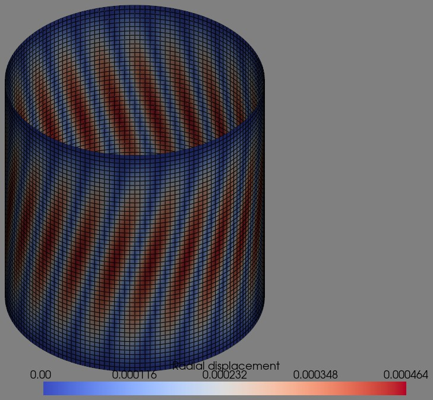

Linear buckling analysis of a cylinder under torsion
====================================================

The cylinders Z11 and Z33 of Castro et al. (2014),
`doi:10.1016/j.compstruct.2014.07.037
<https://doi.org/10.1016/j.compstruct.2014.07.037>`_, two unsymmetric
laminates of :class:`.Quad4` elements, under torsion. The figure shows the
first buckling mode and the element axes, plotted with PyVista using
``refinement=2``:

The laminate of each element is oriented by a material direction along the
axis of the cylinder, see :doc:`conventions`. The asserted torques are a
regression lock of this mesh; the comparison with the semi-analytical
results of the paper is discussed in the comments of the test:

.. literalinclude:: ../../tests/test_quad4_linear_buckling_cylinder_Nxy.py
    :pyobject: test_linear_buckling_cylinder_Nxy
