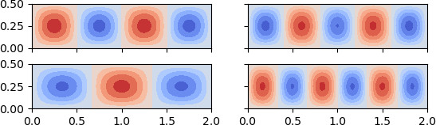

Linear buckling analysis of a plate
===================================

A simply supported plate under uniaxial compression, with :class:`.Quad4R`
elements. The first four buckling modes, computed with ``refinement=3``,
the default of the test:

The geometric stiffness matrix comes from the linear static solution of
the reference load, through ``update_probe_ue`` and ``update_KG``, and the
eigenvalue problem is solved with :func:`.linear_buckling`, see
:doc:`eigenvalue_analyses`. The critical load is compared with the exact
buckling load of the simply supported plate of Leissa, A. W., Vibration of
Plates, NASA SP-160, 1969, Eq. (10.46), within the discretisation error
stated in the docstring:

.. literalinclude:: ../../tests/test_quad4r_linear_buckling_plate.py
    :pyobject: test_linear_buckling_plate

The same plate with :class:`.Quad4` elements and a constant membrane
stress state given directly with ``update_KG_given_stress``:

.. literalinclude:: ../../tests/test_solver.py
    :pyobject: plate_matrices

.. literalinclude:: ../../tests/test_solver.py
    :pyobject: test_linear_buckling_plate
