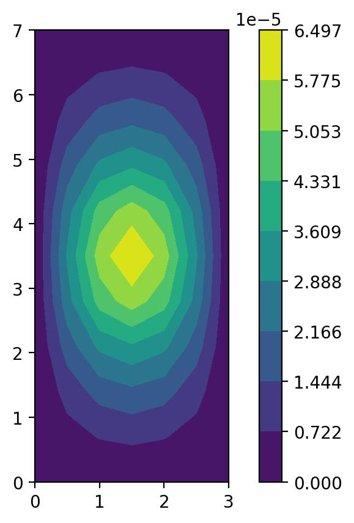

Linear static analysis of a plate
=================================

A simply supported plate of :class:`.Quad4` elements under a central point
load. The figure shows the normal displacement `w`.

The steps are those of :doc:`overview`: the nodes, the property of an
isotropic plate, the elements with their positions ``c1, ..., c4`` and
``init_k_KC0``, the assembly of ``KC0`` with
:class:`scipy.sparse.coo_matrix`, the boundary conditions as the Boolean
arrays ``bk`` and ``bu``, the solution of the free dofs and, at the end,
the internal force vector of ``update_fint``, which balances the load and
the support reactions:

.. literalinclude:: ../../tests/test_quad4_static_point_load.py
    :pyobject: test_static_plate_quad_point_load

The figure is plotted by running the test file as a script.
