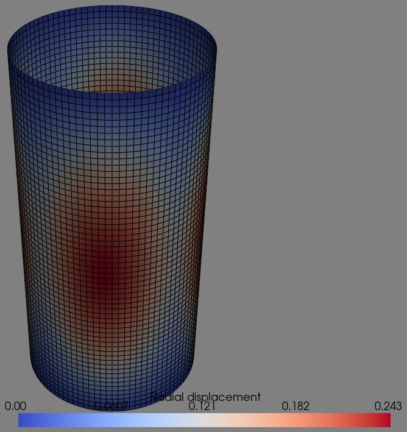

Natural frequency analysis of a cylinder
========================================

The laminated cylinder Z11 of Castro et al. (2014),
`doi:10.1016/j.compstruct.2014.07.037
<https://doi.org/10.1016/j.compstruct.2014.07.037>`_, with the boundary
conditions CC2 of that paper and :class:`.Quad4` elements. The figure shows
the first vibration mode, plotted with PyVista using ``refinement=2``:

The mass matrix is assembled with ``update_M`` and the frequencies are
computed with :func:`.natural_frequency`, see :doc:`eigenvalue_analyses`.
The paper gives the geometry, the material and the stacking sequence only:
the asserted frequencies are a regression lock of this mesh, as explained
in the comments of the test:

.. literalinclude:: ../../tests/test_quad4_natural_freq_cylinder.py
    :pyobject: test_linear_nat_freq_cylinder
